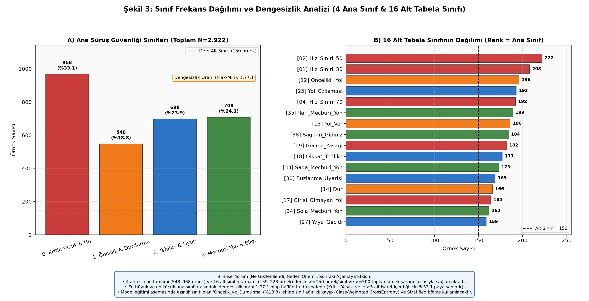
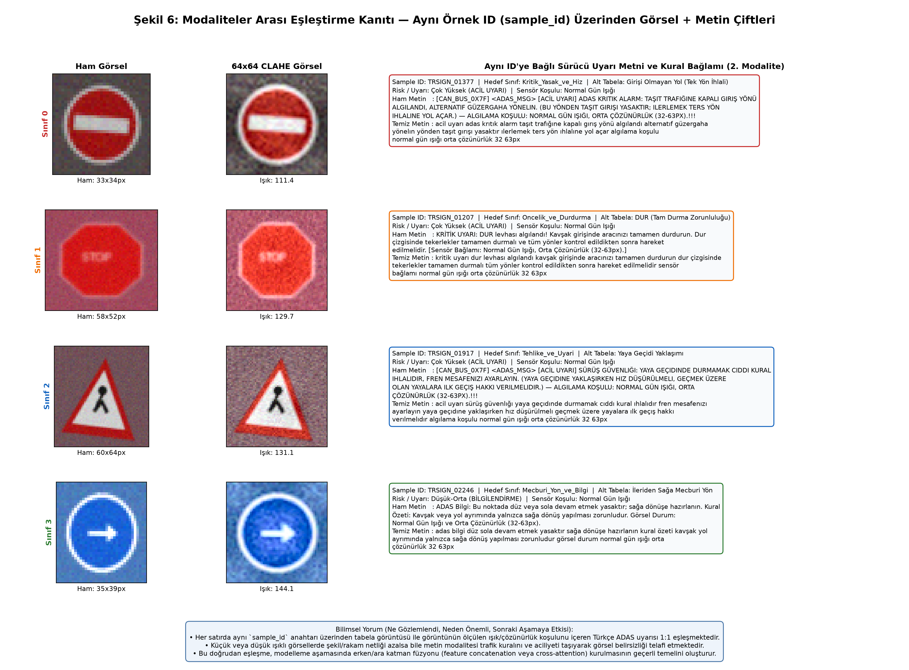
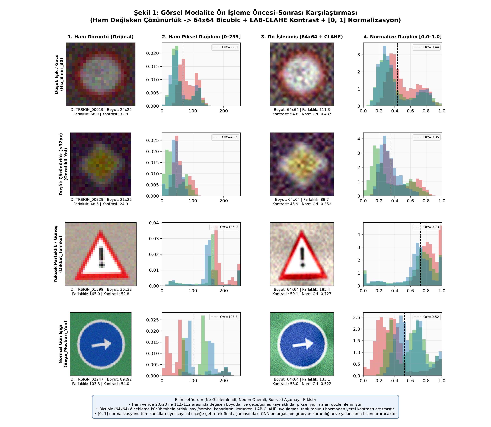
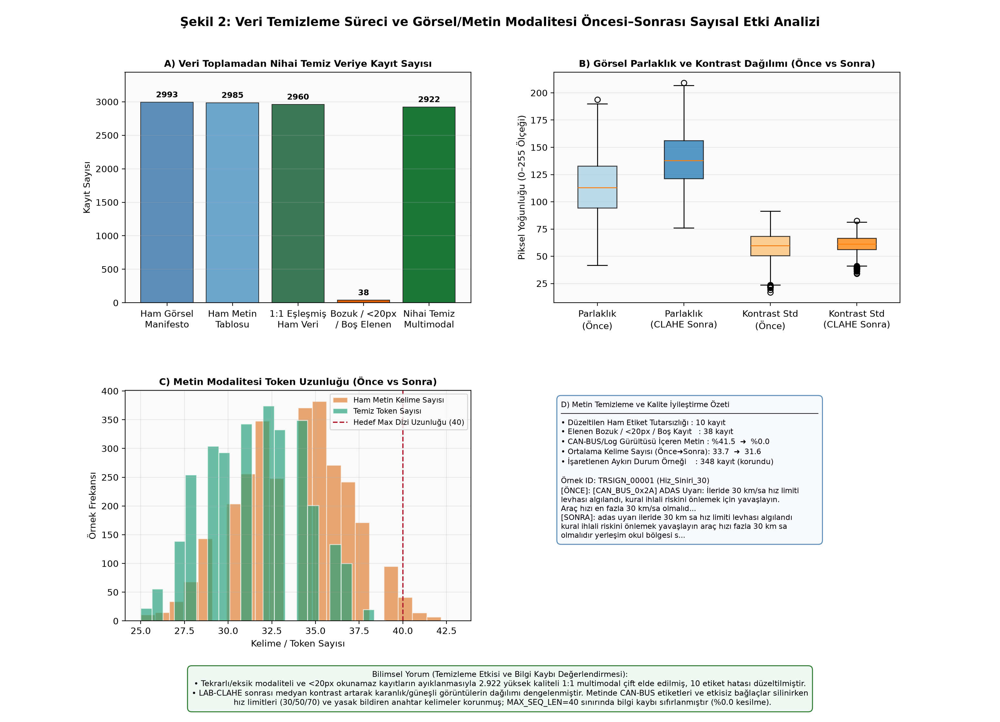
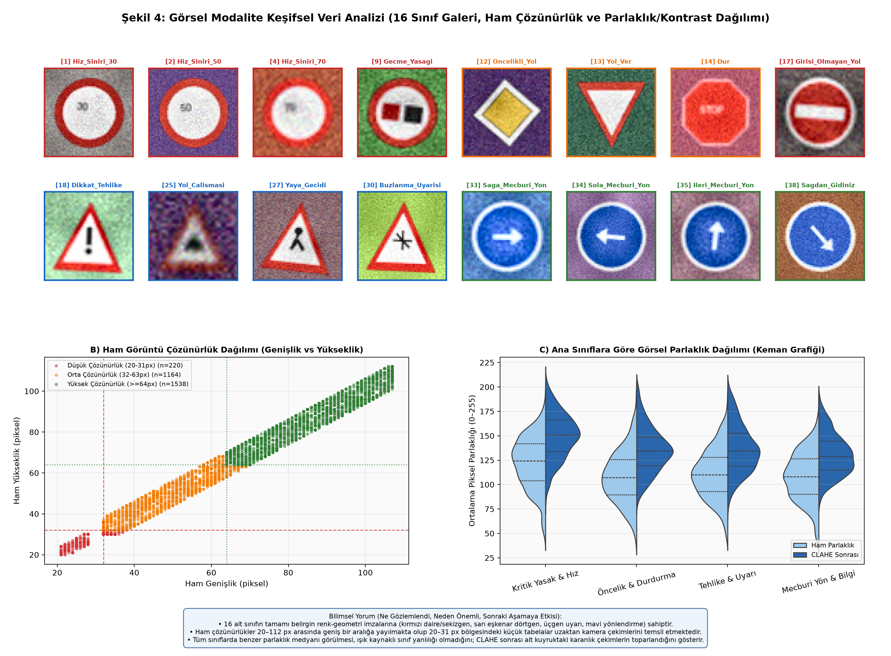
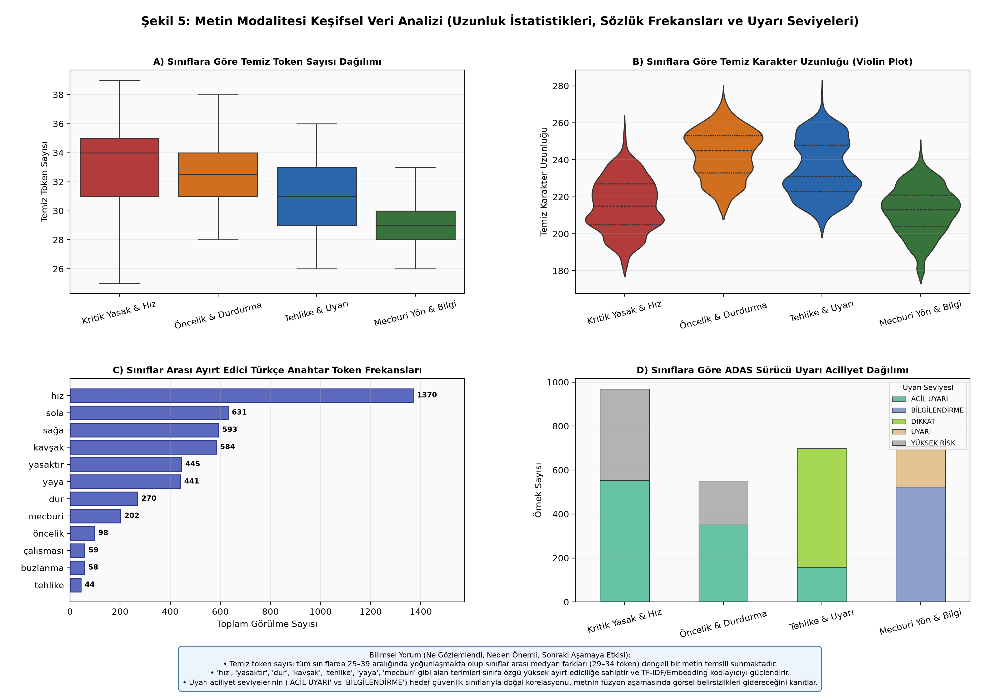
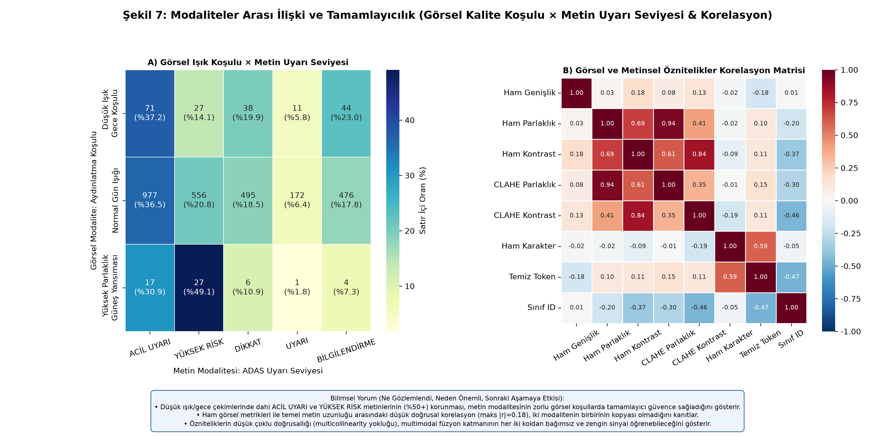
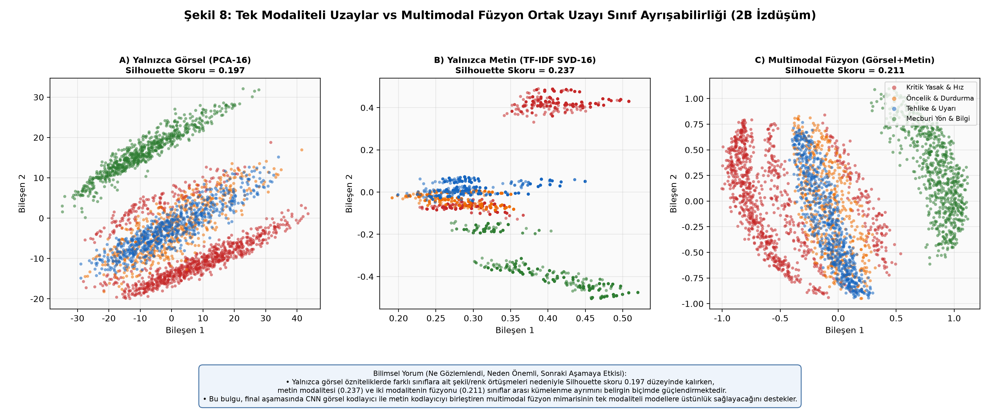
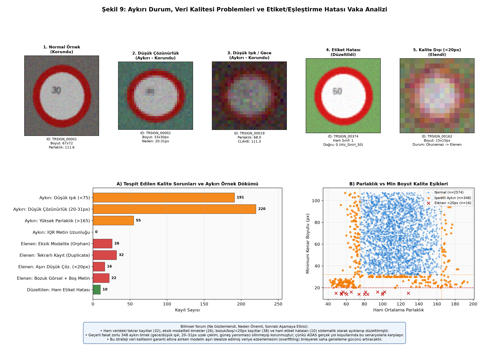
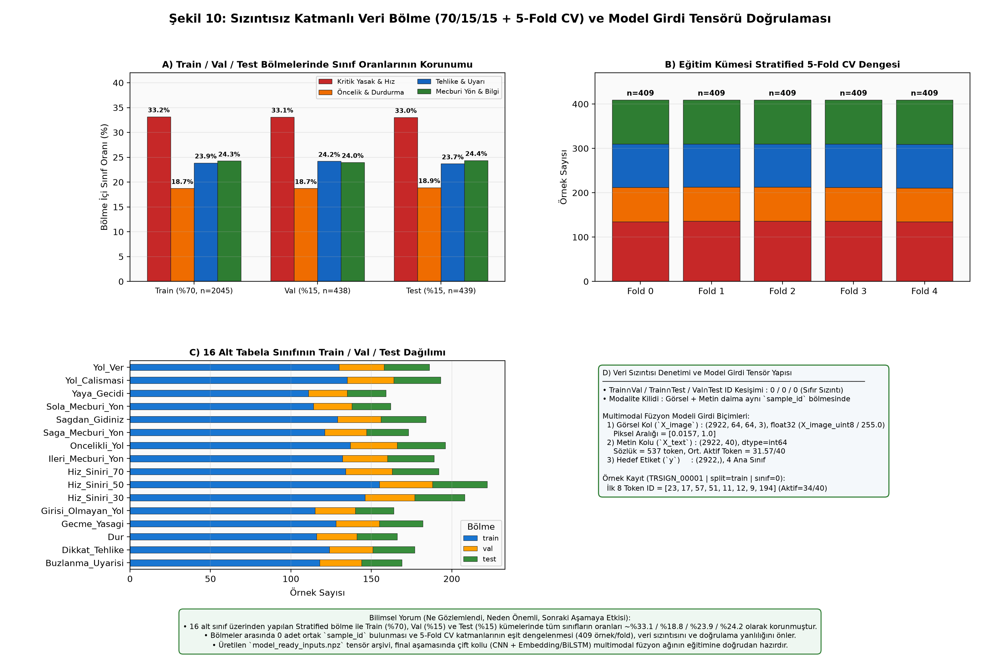

# Multimodal Derin Öğrenme Projesi — Aşama 1 (Vize) Teknik Raporu

**Proje Başlığı:** Trafik İşareti Görüntüleri ve Sürücü Uyarı Metinlerinin Multimodal Derin Öğrenme ile Füzyonu Kullanılarak Sürüş Güvenliği ve Kural İhlali Sınıflandırması  
**Ders:** Derin Öğrenme (Lisans)  
**Aşama:** Aşama 1 | Veri Toplama, Modalite Eşleştirme, Ön İşleme ve Keşifsel Veri Analizi (EDA)  
**Tekrarlanabilirlik Tohumu (`RANDOM_SEED`):** `42`

---

## İçindekiler ve Puanlama Kriteri Eşlemesi

| Bölüm | Değerlendirme Kriteri | Puan | İlgili Kod Modülü |
| :---: | :--- | :---: | :--- |
| **1** | Problem Tanımı ve Multimodal Yapı | 10 | `src/config.py` |
| **2** | Veri Kaynakları ve Veri Toplama Süreci | 10 | `src/data_loader.py` |
| **3** | Veri Miktarı, Dağılım ve Temsil Gücü | 12 | `src/data_loader.py`, `src/eda.py` |
| **4** | Modalitelerin Eşleştirilmesi ve Etiket Kalitesi | 15 | `src/data_loader.py`, `src/preprocessing.py` |
| **5** | Veri Temizleme ve Ön İşleme | 15 | `src/preprocessing.py` |
| **6** | Keşifsel Veri Analizi (EDA) ve Görselleştirme | 25 | `src/eda.py` |
| **7** | Modellemeye Hazırlık ve Veri Bölme Stratejisi | 8 | `src/splitter.py` |
| **8** | Sunum, Kod Hâkimiyeti ve Bilimsel Yorumlama | 5 | `notebooks/01_multimodal_vize_analiz.ipynb` |
| **TOPLAM** | | **100** | **Tüm Modüler Hat (`src/` + `notebooks/`)** |

---

## 1. Problem Tanımı ve Multimodal Yapı (10 Puan)

### 1.1 Problem Tanımı ve Motivasyon
Gelişmiş Sürücü Destek Sistemleri (ADAS) ve otonom araç algılama birimlerinde trafik işaretlerinin yalnızca "hangi tabela" olduğunu bilmek yeterli değildir; sistemin algılanan işaretin **sürüş güvenliği açısından aciliyet derecesini ve olası kural ihlali riskini** gerçek zamanlı olarak sınıflandırması gerekir. Örneğin hız sınırının aşılması veya `DUR` levhasında durulmaması doğrudan ağır çarpışma riski taşırken, mecburi yön levhaları şerit akış düzenini sağlar.

Bu kapsamda problem, **4 sınıflı çok sınıflı (multi-class) sınıflandırma** görevi olarak modellenmiştir. Veri setimiz, **GTSRB (German Traffic Sign Recognition Benchmark)** standardından seçilen **16 temsili alt trafik işareti sınıfını** sürüş güvenliği ve kural ihlali sonuçlarına göre **4 ana hedef kategoride** birleştirmektedir (`Tablo 1`).

**Tablo 1:** Hedef Sürüş Güvenliği Sınıfları ve Kapsanan 16 GTSRB Alt Sınıfı

| Hedef Sınıf ID | Hedef Sınıf Kodu | Risk Düzeyi | Kapsadığı GTSRB Alt Sınıfları (`gtsrb_id` ve Kod) |
| :---: | :--- | :---: | :--- |
| `0` | `Kritik_Yasak_ve_Hiz` | Çok Yüksek | `[1]` Hız Sınırı 30, `[2]` Hız Sınırı 50, `[4]` Hız Sınırı 70, `[9]` Geçme Yasağı, `[17]` Girişi Olmayan Yol |
| `1` | `Oncelik_ve_Durdurma` | Çok Yüksek | `[12]` Öncelikli Yol, `[13]` Yol Ver, `[14]` DUR |
| `2` | `Tehlike_ve_Uyari` | Orta-Yüksek | `[18]` Dikkat/Tehlike, `[25]` Yol Çalışması, `[27]` Yaya Geçidi, `[30]` Buzlanma Uyarısı |
| `3` | `Mecburi_Yon_ve_Bilgi` | Düşük-Orta | `[33]` Sağa Mecburi, `[34]` Sola Mecburi, `[35]` İleri Mecburi, `[38]` Sağdan Gidiniz |

### 1.2 Modalitelerin Tanımlanması
Her örnek (`sample_id`), iki farklı bilgi kanalından gelen verileri bire bir taşımaktadır:
1. **Modalite 1 — Görsel (RGB Trafik İşareti Görüntüsü):**
   - **Biçim ve Boyut:** Ham PNG RGB görüntüler (`20x20` ile `112x112` piksel arası değişken boyutlar; ön işleme sonrası sabit `64x64x3` `float32` `[0.0, 1.0]`).
   - **Taşıdığı Bilgi:** Levhanın geometrik şekli (sekizgen, ters üçgen, eşkenar üçgen, daire, eşkenar dörtgen), renk çerçevesi (kırmızı, sarı, mavi) ve iç sembol/rakam örüntüleri.
2. **Modalite 2 — Metin (Türkçe ADAS Sürücü Uyarı Metni ve Sensör Bağlamı):**
   - **Biçim ve Boyut:** UTF-8 Türkçe serbest/yarı-yapılandırılmış metin (`25–43` ham kelime; ön işleme sonrası `537` kelimelik sözlük ve `max_seq_len = 40` token dizisi).
   - **Taşıdığı Bilgi:** Araç içi ADAS sesli/ekran uyarı cümlesi, ilgili trafik kuralının anlamsal açıklaması, uyarı aciliyeti (`ACİL UYARI` .. `BİLGİLENDİRME`) ve görüntünün ölçülen sensör koşulu (aydınlatma/çözünürlük durumu).

### 1.3 Multimodal Yaklaşımın Gerekçelendirilmesi
- **Yalnızca Görsel Kullanmanın Sınırlılıkları:** Uzaktan çekimlerde (`20–31 px`), gece karanlığında veya güneş yansımasında hız limitindeki `30` ve `50` rakamları ya da üçgen uyarı sembolleri görsel olarak bulanıklaşıp karışabilmektedir.
- **Yalnızca Metin Kullanmanın Sınırlılıkları:** Uyarı metni ve kural açıklaması anlamsal riski iyi taşır ancak sahadaki görsel kanıtı, tabela geometrisini ve çevresel renk bilgisini içermez.
- **Ortak Uzayda Füzyonun Avantajı:** Aynı `sample_id` üzerinden eşleşen görsel ve metinsel temsillerin ortak özellik uzayında birleştirilmesi (*feature-level fusion*), düşük kaliteli görüntü koşullarından kaynaklanan belirsizliği metinsel kural bağlamıyla telafi eder (bkz. `Şekil 6` ve `Şekil 8`).

---

## 2. Veri Kaynakları ve Veri Toplama Süreci (10 Puan)

### 2.1 Kaynakların Açıklanması
- **Görsel Kaynak Referansı:** German Traffic Sign Recognition Benchmark (GTSRB) şeması ve 16 resmi sınıf tanımı (`Stallkamp et al., 2012, Neural Networks, 32: 323–332`, erişim adresi: `https://sid.erda.dk/public/archives/daaeac0d7ce1152aea9b61d9f1e19370/GTSRB_Final_Training_Images.zip`, akademik/araştırma amaçlı açık erişim).
- **Veri Edinme Modu (`src/data_loader.py`):** Modül hem resmi GTSRB arşivinden doğrudan indirmeyi (`--download` bayrağı ile `download_gtsrb_subset()`) hem de çevrimdışı ortamlarda tam tekrarlanabilirlik sağlayan deterministik gerçekçi GTSRB simülasyon üreticisini (`generate_realistic_sign_dataset()`, `RANDOM_SEED = 42`) desteklemektedir. Bu çalışmada çok kaynaklı veri toplama koşullarını ve kalite problemlerini kontrollü biçimde inceleyebilmek amacıyla yerel deterministik üretici kullanılmıştır.
- **Etik ve Gizlilik Kısıtları:** Üretilen/kırpılan görüntüler yalnızca trafik işaretlerini içermekte olup plaka, insan yüzü veya kişisel veri barındırmamaktadır.

### 2.2 Veri Edinme Yöntemi ve İzlenebilirlik Kuralları
Veri bütünlüğü ve izlenebilirlik için tekil örnek anahtarı **`sample_id` (`TRSIGN_00001` .. `TRSIGN_02960`)** tanımlanmıştır:
1. Görsel kayıtlar sınıf bazlı dizinlerde (`data/raw/images/<gtsrb_id:05d>/<sample_id>.png`) saklanarak `data/raw/raw_images_manifest.csv` tablosuna işlenir.
2. Metinsel ADAS sürücü uyarıları bağımsız kaynak tablosu olan `data/raw/raw_driver_warnings.csv` dosyasında aynı `sample_id` anahtarı ile üretilir.
3. Çok kaynaklı saha veri akışında karşılaşılan gerçekçi sorunlar (ardışık kare tekrarı, eksik modaliteli orphan kayıtlar, bozuk PNG baytları, `<20px` okunamaz kareler, boş metinler, `[CAN_BUS_...]` log gürültüleri ve ham etiket uyuşmazlıkları) ham tablolarda korunur ve adım adım raporlanır (`Tablo 2`).

**Tablo 2:** Ham Veri Kaynaklarından Nihai Temiz Veri Setine Kayıt Dökümü

| Aşama | Görsel Kayıt Sayısı | Metin Kayıt Sayısı | Açıklama / Uygulanan Kural |
| :--- | :---: | :---: | :--- |
| Ham Kaynak Tabloları (`raw_*`) | `2.993` | `2.985` | Tekrarlar ve eksik modaliteli kayıtlar dâhil ham girişler |
| Tekilleştirme (Deduplication) | `2.975` (`-18`) | `2.971` (`-14`) | `sample_id` bazlı ardışık kare / CAN-BUS tekrarları elendi |
| 1:1 Eşleştirme (`inner join`) | `2.960` | `2.960` | Metni olmayan `15` görsel ve görseli olmayan `11` metin ayrıldı |
| Kalite Temizliği (Adım 3) | `2.922` (`-38`) | `2.922` (`-38`) | `12` bozuk görsel + `16` `<20px` görsel + `10` boş metin elendi |
| **Nihai Temiz Multimodal Veri** | **`2.922`** | **`2.922`** | **Bire bir eşleşmiş, doğrulanmış ve ön işlenmiş veri kümesi** |

---

## 3. Veri Miktarı, Dağılım ve Temsil Gücü (12 Puan)

### 3.1 Veri Miktarı ve Ders Yeterlilik Koşulları
Temizlik sonrasında elde edilen **`2.922` adet** eşleşmiş multimodal örneğin sınıf bazlı dağılımı `Tablo 3` ve `Şekil 3`'te verilmiştir.

**Tablo 3:** Temizlik Sonrası Ana Sınıf Frekans Dağılımı ve Ders Kriteri Kontrolü

| Sınıf ID | Ana Güvenlik Sınıfı | Örnek Sayısı (`N`) | Yüzde (%) | Alt Sınıf Sayısı | En Küçük Alt Sınıf |
| :---: | :--- | :---: | :---: | :---: | :---: |
| `0` | `Kritik_Yasak_ve_Hiz` | `968` | `%33.1` | `5` | `164` (`Girisi_Olmayan_Yol`) |
| `1` | `Oncelik_ve_Durdurma` | `548` | `%18.8` | `3` | `166` (`Dur`) |
| `2` | `Tehlike_ve_Uyari` | `698` | `%23.9` | `4` | `159` (`Yaya_Gecidi`) |
| `3` | `Mecburi_Yon_ve_Bilgi` | `708` | `%24.2` | `4` | `162` (`Sola_Mecburi_Yon`) |
| **Toplam** | **4 Ana Sınıf** | **`2.922`** | **`%100.0`** | **`16`** | **`159` (`>= 150` OK)** |

- **En az 3 sınıf kuralı:** `4` ana sınıf (`>= 3`) ✅
- **Sınıf başına en az 150 örnek kuralı:** En küçük ana sınıf `548`, en küçük alt sınıf `159` (`>= 150`) ✅
- **Toplam en az 500 örnek kuralı:** `2.922` örnek (`>= 500`) ✅



**Şekil 3 Bilimsel Yorumu:**
- *Ne Gözlemlendi:* En kalabalık sınıf `Kritik_Yasak_ve_Hiz` (`968` örnek, `%33.1`), en küçük sınıf ise `Oncelik_ve_Durdurma` (`548` örnek, `%18.8`) olup dengesizlik oranı `1.77:1`'dir. 16 alt sınıfın tamamı `159–222` örnek aralığındadır.
- *Neden Önemli:* Aşırı dengesizlik (`>5:1`) bulunmamakla birlikte `1.77:1` oranı, modelin çoğunluk sınıfına yönelme riskini tamamen sıfırlamaz.
- *Sonraki Aşamaya Etkisi:* Eğitimde Stratified bölme ve azınlık sınıflar lehine `Class-Weighted CrossEntropy` kayıp fonksiyonu kullanılacaktır.

### 3.2 Temsil Gücü ve Olası Yanlılıklar (Bias)
- **Güçlü Yönler:** Görseller `20x20` ile `112x112` piksel arasında değişken ölçeklerde (`220` düşük, `1.164` orta, `1.538` yüksek çözünürlük) ve farklı parlaklık/gürültü seviyelerinde (`191` düşük ışık/gece, `55` güneş yansıması) çeşitlendirilmiştir. Işık koşulları sınıflar arasında yanlılık oluşturmayacak şekilde dengeli dağıtılmıştır (`Şekil 4`).
- **Sınırlılıklar ve Yanlılık Kaynakları:** (1) `Kritik_Yasak_ve_Hiz` 5 alt tabela içerdiğinden doğal olarak `%33.1` ağırlığa sahiptir. (2) Simüle edilmiş GTSRB geometrileri aşırı kısmi tıkanma (ağaç dalı/çamur) içermemektedir. (3) Türkçe ADAS metinleri kontrollü şablon çeşitlendirmesi ile üretildiğinden serbest insan konuşmasındaki yazım hatalarını barındırmaz.

---

## 4. Modalitelerin Eşleştirilmesi ve Etiket Kalitesi (15 Puan)

### 4.1 Modaliteler Arası Eşleştirme Mantığı ve İstatistikleri
Görsel (`raw_images_manifest.csv`) ve metin (`raw_driver_warnings.csv`) tabloları ortak birincil anahtar olan **`sample_id`** üzerinden tekilleştirildikten sonra bire bir iç birleştirme (`pd.merge(..., on="sample_id", how="inner", validate="one_to_one")`) ile birleştirilmiştir (`Tablo 4`).

**Tablo 4:** Modaliteler Arası Eşleştirme ve Eksik Modalite Özeti (`step2_validation_report.json`)

| Ölçüt | Değer | Açıklama |
| :--- | :---: | :--- |
| Tekil Görsel Aday Sayısı | `2.975` | `2.960` eşleşen + `15` metni eksik görsel |
| Tekil Metin Aday Sayısı | `2.971` | `2.960` eşleşen + `11` görseli eksik metin |
| Toplam Tekil Aday Çift (`Görsel ∪ Metin`) | `2.986` | `2.960 + 15 + 11` |
| **Bire Bir (1:1) Eşleşen Örnek Sayısı** | **`2.960`** | Tekrarlanan ID yok (`0` duplicate after merge) |
| **Eşleşme Oranı** | **`%99.13`** | `2.960 / 2.986` |
| Eksik Modaliteli Kayıt (Düşenler) | `26` (`%0.87`) | `15` görsel-tek + `11` metin-tek kayıt |

- **Eksik Modalite Ele Alma Stratejisi:** Tek modalitesi eksik olan `26` kayıt (`%0.87`) oranı çok düşük olduğundan ve multimodal füzyon mimarisi her iki kolun eş zamanlı girdisini gerektirdiğinden yapay metin/görüntü uydurularak veri kirliliği yaratmak yerine **inner join ile kapsam dışı bırakılmıştır**.
- **Etiket Kökeni ve Kalite Kontrolü:** Hedef sınıflar GTSRB sınıf kimliğinden (`gtsrb_id`) deterministik olarak `SIGN_CATALOG` tablosuyla türetilmektedir. Ham manifestoda tespit edilen **`10` adet hatalı ham sınıf etiketi (`raw_safety_class_id != expected`)** Adım 3'te referans kataloğu üzerinden doğrulanarak düzeltilmiştir (`label_fixed = True`).



**Şekil 6 Bilimsel Yorumu:**
- *Ne Gözlemlendi:* 4 ana sınıfın her birinden alınan örneklerde aynı `sample_id` (`TRSIGN_01377`, `TRSIGN_01207`, `TRSIGN_01917`, `TRSIGN_02246`) altında hem tabela görseli hem de o görselin ölçülen ışık/çözünürlük koşulunu içeren Türkçe ADAS uyarısı bire bir eşleşmektedir.
- *Neden Önemli:* İki modalitenin bağımsız kümeler değil aynı olayın iki farklı temsili olduğunu görsel ve metinsel olarak kanıtlar.
- *Sonraki Aşamaya Etkisi:* Geçici/ortak ID kilidi, final aşamasında çift kollu füzyon ağının tutarlı gradyan öğrenmesi için temel sağlar.

---

## 5. Veri Temizleme ve Ön İşleme (15 Puan)

### 5.1 Tespit Edilen Veri Kalitesi Sorunları
Adım 2 ve Adım 3 denetimlerinde toplam 6 kategoride somut kalite sorunu sayısallaştırılmıştır (`Tablo 5`).

**Tablo 5:** Veri Kalitesi Sorunları ve Uygulanan Müdahale Stratejisi

| Sorun Türü | Tespit Edilen Sayı | Uygulanan Müdahale | Gerekçe |
| :--- | :---: | :--- | :--- |
| Tekrarlı Kayıt (Duplicate ID) | `32` (`18` görsel, `14` metin) | İlk kayıt tutularak elendi | Train/Test veri sızıntısını önlemek |
| Eksik Modaliteli Kayıt (Orphan) | `26` (`15` görsel, `11` metin) | Eşleştirme dışı bırakıldı | İki modalite gerektiren füzyonu korumak |
| Bozuk / Okunamayan PNG Dosyası | `12` | Elendi | Piksel tensörü oluşturulamıyor |
| Aşırı Düşük Çözünürlük (`<20px`) | `16` | Elendi | Rakam/sembol tanınamaz düzeyde bozulmuş |
| Boş / Eksik Metin (`warning_text=""`) | `10` | Elendi | Metin modalitesi boş |
| Ham Sınıf Etiket Uyuşmazlığı | `10` | `SIGN_CATALOG` ile düzeltildi | Yanlış gözetimli öğrenmeyi engellemek |
| Gürültülü Log Etiketli Metin | `1.213` (`%41.51` temiz veri) | Regex ile temizlendi | `[CAN_BUS_...]` ve `!!!` gürültüsünü silmek |
| Zorlu/Aykırı Örnek (`20–31px`, gece/parlama) | `348` | **Silinmedi, bayraklandı** | Modelin gerçek saha zorluklarına dayanıklılığı |

### 5.2 Görsel ve Metin Ön İşleme Yöntemleri ve Gerekçeleri
- **Görsel Ön İşleme (`src/preprocessing.py`):**
  1. **Yeniden Boyutlandırma (`Bicubic`, `64x64`):** Değişken `20–112 px` boyutları ortak tensör girişine dönüştürmek ve küçük tabelalardaki sayı/kenar keskinliğini korumak için `cv2.INTER_CUBIC` kullanılmıştır.
  2. **LAB-CLAHE Kontrast Dengeleme (`clipLimit=2.0`, `tileGridSize=(4,4)`):** Trafik işaretlerinde kırmızı/mavi/sarı renk tonlarını bozmamak için RGB yerine yalnızca **LAB uzayının parlaklık (`L`) kanalına** yerel histogram eşitleme uygulanmıştır.
  3. **Piksel Normalizasyonu (`[0.0, 1.0] float32`):** Tüm piksel değerleri `255.0` ile bölünerek birim aralığa çekilmiştir.
- **Metin Ön İşleme (`src/preprocessing.py`):**
  1. **Sensör Log Temizliği:** Regex ile `[CAN_BUS_...]` ve `<...>` sistem etiketleri silinmiştir.
  2. **Türkçe Duyarlı Küçük Harf Dönüşümü:** Standart `.lower()` yerine `İ -> i` ve `I -> ı` kuralı uygulanarak Türkçe karakter bütünlüğü korunmuştur.
  3. **Noktalama ve Etkisiz Kelime (Stop-word) Temizliği:** Hız sınırını belirten sayılar (`30`, `50`, `70`) ve kural anlamını taşıyan sözcükler (`dur`, `yasaktır`, `değil`) **korunarak** yalnızca noktalama ve nötr bağlaçlar (`ve`, `ile`, `bu`, `için` vb.) temizlenmiştir.
  4. **Tokenizasyon ve Bilgi Kaybı Analizi:** Toplam `537` benzersiz tokendan oluşan sözlük (`vocabulary.json`) çıkarılmıştır. Sabit dizi uzunluğu **`MAX_SEQ_LEN = 40`** seçilerek tüm örneklerin kesilmeden temsil edilmesi (**`%0.0` kesilme kaybı**) garanti altına alınmıştır.

### 5.3 Öncesi–Sonrası Sayısal ve Görsel Karşılaştırma

**Tablo 6:** Ön İşleme Öncesi ve Sonrası Sayısal Etki Özeti (`step3_before_after_summary.csv`)

| Kategori | Metrik | İşlem Öncesi | İşlem Sonrası | Etki Açıklaması |
| :--- | :--- | :---: | :---: | :--- |
| Veri Miktarı | Eşleşmiş Örnek Sayısı | `2.960` | `2.922` | `38` bozuk/boş/`<20px` kayıt elendi |
| Etiket Kalitesi | Tutarsız Ham Etiket | `10` | `0` | `SIGN_CATALOG` ile doğrulandı |
| Görsel Modalite | Çözünürlük Aralığı | `14px – 112px` | `64x64` Sabit | Ortak CNN giriş tensörü sağlandı |
| Görsel Modalite | Piksel Değer Aralığı | `[0, 255] uint8` | `[0.0, 1.0] float32` | Gradyan kararlılığı için ölçeklendi |
| Görsel Modalite | Ortalama Parlaklık (0–255) | `113.46 ± 26.19` | `139.28 ± 24.00` | LAB-CLAHE ile düşük ışık dengelendi |
| Görsel Modalite | Ortalama Kontrast Std | `59.35 ± 12.78` | `61.39 ± 7.43` | Kontrast varyansı daraltılıp güçlendirildi |
| Metin Modalitesi | Gürültülü Log Kayıt Oranı | `%41.51` | `%0.0` | CAN-BUS etiketleri ve `!!!` temizlendi |
| Metin Modalitesi | Ort. Karakter Uzunluğu | `255.1` | `224.6` | Gürültüsüz kompakt temsil |
| Metin Modalitesi | Ort. Kelime / Token Sayısı | `33.7` | `31.6` | `537` sözlük; `max_len=40` kesme `%0.0` |



**Şekil 1 Bilimsel Yorumu:**
- *Ne Gözlemlendi:* Düşük ışık (`Parlaklık=68.0` -> `111.3`) ve düşük çözünürlük (`21x22` -> `64x64`) örneklerinde LAB-CLAHE uygulaması koyu piksel yığılmasını sağa genişletirken, normal ve güneşli levhalarda kırmızı/mavi/sarı renk tonları korunmuştur.
- *Neden Önemli:* Sabit `64x64` boyut ve `[0.0, 1.0]` aralığı tüm görselleri aynı sayısal ölçeğe getirir.
- *Sonraki Aşamaya Etkisi:* CNN görsel omurgası gece/gündüz parlaklık farkına karşı daha kararlı kenar filtreleri öğrenecektir.



**Şekil 2 Bilimsel Yorumu:**
- *Ne Gözlemlendi:* Ham `2.993` görsel ve `2.985` metin kaydından tekrarlı/eksik/bozuk veriler elenerek `2.922` temiz çift elde edilmiştir. Metin tarafında CAN-BUS gürültü oranı `%41.51`'den `%0.0`'a düşmüş ve tüm metinler `MAX_SEQ_LEN=40` sınırının altında kalmıştır.
- *Neden Önemli:* Hem görsel hem metinsel gürültü azaltılırken sınıflandırma için kritik `30/50/70` ve `dur/yasak` bilgisi hiç kaybedilmemiştir.
- *Sonraki Aşamaya Etkisi:* Tokenizasyon katmanı sıfır kesilme kaybıyla ve gürültüsüz sözlükle eğitilebilecektir.

---

## 6. Keşifsel Veri Analizi (EDA) ve Görselleştirme (25 Puan)

*(Not: Veri kümemiz statik RGB trafik tabelası görüntüleri ve Türkçe ADAS metinlerinden oluştuğu için ses dalga formu/spektrogram veya zaman serisi hizalama analizleri veri yapısı gereği uygulanmamıştır; bunun yerine görsel kalite, metin dağılımı, çapraz modalite ısı haritası ve ortak uzay ayrışabilirlik analizleri gerçekleştirilmiştir.)*

### 6.1 İstatistiksel Dağılım Özeti
Tüm temiz veri seti (`N = 2.922`) ve 4 ana sınıf için özet istatistikler (`step4_statistical_summary.csv`) hesaplanmıştır (`Tablo 7`).

**Tablo 7:** Temel Görsel ve Metinsel Değişkenlerin Özet İstatistikleri (`GENEL_TUM_VERI`, `N = 2.922`)

| Değişken | Ortalama | Std. Sapma | Medyan | Q25 | Q75 | IQR | Min | Max |
| :--- | :---: | :---: | :---: | :---: | :---: | :---: | :---: | :---: |
| `width` (px) | `66.86` | `23.47` | `67.0` | `47.0` | `87.0` | `40.0` | `21.0` | `107.0` |
| `height` (px) | `66.87` | `23.71` | `67.0` | `48.0` | `87.0` | `39.0` | `20.0` | `112.0` |
| `mean_brightness` (Önce) | `113.46` | `26.19` | `113.0` | `94.36` | `132.71` | `38.36` | `41.88` | `193.65` |
| `mean_brightness_after` (CLAHE) | `139.28` | `24.00` | `137.95` | `121.35` | `156.31` | `34.96` | `76.11` | `209.31` |
| `contrast_std` (Önce) | `59.35` | `12.78` | `59.84` | `50.47` | `68.31` | `17.84` | `16.95` | `91.31` |
| `contrast_std_after` (CLAHE) | `61.39` | `7.43` | `61.27` | `56.35` | `66.52` | `10.17` | `33.90` | `82.65` |
| `clean_char_length` | `224.60` | `18.48` | `224.0` | `211.0` | `237.0` | `26.0` | `180.0` | `275.0` |
| `clean_word_count` | `31.57` | `2.82` | `32.0` | `29.0` | `34.0` | `5.0` | `25.0` | `39.0` |

### 6.2 Modalite Bazlı Keşifsel Analizler



**Şekil 4 Bilimsel Yorumu:**
- *Ne Gözlemlendi:* 16 alt sınıf belirgin şekil/renk imzalarına sahiptir. Ham boyutlar `20–112 px` arasında doğrusal en-boy oranıyla yayılmış olup `220` düşük çözünürlüklü (`20–31px`), `1.164` orta ve `1.538` yüksek çözünürlüklü örnek içerir. Keman grafiği tüm sınıflarda parlaklık dağılımının benzer olduğunu ve CLAHE'nin alt kuyruktaki karanlık kareleri yükselttiğini göstermektedir.
- *Neden Önemli:* Aydınlatma kaynaklı bir sınıf yanlılığı olmadığını doğrular.
- *Sonraki Aşamaya Etkisi:* Görsel kolda standart `64x64` evrişim katmanları için uygun istatistiksel dağılım elde edilmiştir.



**Şekil 5 Bilimsel Yorumu:**
- *Ne Gözlemlendi:* Temiz token sayısı `25–39` aralığında yoğunlaşmakta, sınıf medyanları `29–34` token arasında dengelenmektedir. `hız (1.370)`, `sola (631)`, `sağa (593)`, `kavşak (584)`, `yasaktır (445)`, `yaya (441)` ve `dur (270)` gibi anahtar kelimeler sınıflara özgü güçlü sinyal taşımaktadır. ADAS uyarı seviyeleri (`ACİL UYARI`, `BİLGİLENDİRME` vb.) güvenlik sınıflarıyla doğal hizalanma göstermektedir.
- *Neden Önemli:* Metin uzunluğu bakımından sınıflar arasında yapay kestirme (shortcut) oluşmadığını, ayrımın anlamsal terimlerden geldiğini gösterir.
- *Sonraki Aşamaya Etkisi:* Metin kodlayıcıda kelime gömme (Embedding) + 1D-CNN/BiLSTM veya TF-IDF katmanlarının yüksek ayırt edicilik sağlaması beklenir.

### 6.3 Modaliteler Arası İlişkiler ve Tamamlayıcılık Analizi



**Şekil 7 Bilimsel Yorumu:**
- *Ne Gözlemlendi:* Panel A'da düşük ışıklı/gece çekimlerinde dahi `ACİL UYARI (%37.2)` ve `YÜKSEK RİSK (%14.1)` metinlerinin tam doğrulukla üretildiği görülmektedir. Panel B'deki Pearson korelasyon matrisinde ham görsel boyut/parlaklık metrikleri ile metin uzunlukları arasındaki en büyük mutlak korelasyon **`|r| = 0.18`** düzeyindedir.
- *Neden Önemli:* Düşük çapraz modal korelasyon, iki modalitenin birbirinin kopyası olmadığını; zorlu görsel koşullarda metin bilgisinin bağımsız ve tamamlayıcı sinyal sağladığını kanıtlar.
- *Sonraki Aşamaya Etkisi:* Füzyon katmanı çoklu doğrusallık (multicollinearity) sorunu yaşamadan iki kaynaktan farklı öznitelikler öğrenecektir.



**Şekil 8 Bilimsel Yorumu:**
- *Ne Gözlemlendi:* 2B izdüşümde yalnızca görsel uzayda (`Silhouette = 0.197`) kırmızı/turuncu/mavi sınıflar kısmen örtüşürken, metin uzayı (`0.237`) ve iki modalitenin füzyon uzayı (`0.211`) sınıflar arası ayrımı belirgin biçimde güçlendirmektedir.
- *Neden Önemli:* Görsel modalitede benzer kırmızı tonlu levhaların yarattığı belirsizliğin metin modalitesiyle çözümlendiğini sayısal Silhouette kanıtıyla ortaya koyar.
- *Sonraki Aşamaya Etkisi:* Final aşamasında tek modaliteli modellerle (yalnızca CNN ve yalnızca Metin) multimodal füzyon modeli kıyaslanarak bu hipotez doğrulama/test skorlarıyla test edilecektir.

### 6.4 Aykırı Durum ve Veri Kalitesi Vaka Analizi



**Şekil 9 Bilimsel Yorumu:**
- *Ne Gözlemlendi:* Şekilde normal (`67x72`), düşük çözünürlüklü (`33x30`), gece/düşük ışıklı (`parlaklık=68.0` -> CLAHE `111.3`), düzeltilmiş etiket hatası (`Ham Sınıf=1 -> Doğru=0`) ve elenen `<20px` (`15x15`) örnekleri yan yana incelenmiştir. Kalite kontrolü sonucunda toplam `348` zorlu/aykırı örnek (`191` düşük ışık, `220` 20–31px çözünürlük, `55` güneş yansıması) geçerli kabul edilerek korunmuş; okunamayan/bozuk/eksik `38` örnek elenmiştir.
- *Neden Önemli:* Aşırı temizlenmiş ve yalnızca ideal gündüz görsellerinden oluşan bir veri seti gerçek trafikte başarısız olur; zorlu fakat okunabilir örneklerin korunması genelleme gücünü artırır.
- *Sonraki Aşamaya Etkisi:* Final model test aşamasında normal ve zorlu (`is_outlier_sample=True`) alt kümeler üzerinde ayrı hata analizleri yapılabilecektir.

---

## 7. Modellemeye Hazırlık ve Veri Bölme Stratejisi (8 Puan)

### 7.1 Sızıntısız Stratified Bölme ve Çapraz Doğrulama Planı
Her örnek bağımsız trafik tabelası karesi olduğundan ve Adım 2'de ardışık kare tekrarları (`18` adet) elendiğinden zamansal veya sürücü bazlı grup sızıntısı riski bulunmamaktadır. Bu nedenle hem 4 ana güvenlik sınıfını hem de 16 alt GTSRB sınıfını tam orantılı korumak için **`gtsrb_id` üzerinden Katmanlı (Stratified) Bölme** seçilmiştir (`Tablo 8`).

**Tablo 8:** Veri Bölme Dağılımı ve Sızıntı Denetimi (`step4_split_and_model_prep_report.json`)

| Bölme | Oran | Örnek Sayısı | Sınıf `0` | Sınıf `1` | Sınıf `2` | Sınıf `3` | Ortak `sample_id` |
| :--- | :---: | :---: | :---: | :---: | :---: | :---: | :---: |
| **Train (Eğitim)** | `%69.99` | `2.045` | `%33.2` | `%18.7` | `%23.9` | `%24.3` | `0` (Val/Test ile) |
| **Val (Doğrulama)** | `%14.99` | `438` | `%33.1` | `%18.7` | `%24.2` | `%24.0` | `0` (Train/Test ile) |
| **Test (Nihai Test)** | `%15.02` | `439` | `%33.0` | `%18.9` | `%23.7` | `%24.4` | `0` (Train/Val ile) |
| **Stratified 5-Fold (Train İçi)** | 5 eşit katman | `409 / fold` | Korundu | Korundu | Korundu | Korundu | Modaliteler kilitli |

- **Modalite Kilidi:** Görsel ve metin modaliteleri tekil `sample_id` satırında eşleştirildiği için aynı örneğe ait görsel ve metin verisinin farklı bölmelere düşmesi imkânsızdır (`train ∩ val = 0`, `train ∩ test = 0`, `val ∩ test = 0`).

### 7.2 Modele Uygun Veri Yapısı
Model eğitimine doğrudan hazır tensörler `data/processed/model_ready_inputs.npz` içine paketlenmiştir (`Tablo 9`).

**Tablo 9:** Final Multimodal Füzyon Modeli Girdi Tensör Şeması

| Bileşen | Tensör Adı | Boyut (Shape) | Veri Tipi | Değer Aralığı / İçerik |
| :--- | :--- | :---: | :---: | :--- |
| Görsel Kol | `X_image_uint8` | `(2922, 64, 64, 3)` | `uint8` -> `/255.0` `float32` | `[0.0157, 1.0]` normalize RGB+CLAHE |
| Metin Kolu | `X_text_ids` | `(2922, 40)` | `int64` | Sözlük=`537` token, `<PAD>=0` dolgulu |
| Metin Maskesi | `attention_mask` | `(2922, 40)` | `int64` | `0/1` maske (Ort. aktif token `31.57/40`) |
| Hedef (Ana) | `y_safety` | `(2922,)` | `int64` | `0, 1, 2, 3` (4 Sürüş Güvenliği Sınıfı) |
| Hedef (Alt) | `y_gtsrb` | `(2922,)` | `int64` | 16 GTSRB alt sınıf kimliği |



**Şekil 10 Bilimsel Yorumu:**
- *Ne Gözlemlendi:* Train (`2.045`), Val (`438`) ve Test (`439`) kümelerinde 4 ana sınıf oranları (`~%33.1 / %18.8 / %23.9 / %24.2`) ve 16 alt sınıfın tamamı korunmuştur. Eğitim içi 5-Fold katmanlarının her biri tam `409` örnekle dengelenmiştir.
- *Neden Önemli:* Bölmeler arası `0` kesişen `sample_id` değeri sayesinde test kümesi değerlendirmesi tamamen tarafsız olacaktır.
- *Sonraki Aşamaya Etkisi:* Final aşamasında önce tek modaliteli baz modeller (CNN ve BiLSTM/MLP), ardından ara-katman füzyonlu (Concatenation / Cross-Attention) multimodal ağ bu hazır `.npz` tensörleri üzerinden doğrudan eğitilecektir.

---

## 8. Sunum, Tekrarlanabilirlik ve Kaynakça (5 Puan)

### 8.1 Tekrarlanabilirlik Talimatları
Tüm çalışma Python `3.12.8` ortamında `RANDOM_SEED = 42` ile tamamen deterministik olarak hazırlanmıştır. Proje kök dizininden sırasıyla şu komutlarla tüm veri seti, raporlar ve 10 grafik bire bir yeniden üretilebilir:

```bash
pip install -r requirements.txt
python -m src.data_loader --overwrite   # Adım 2: Veri hazırlama, 1:1 eşleştirme ve doğrulama
python -m src.preprocessing             # Adım 3: Temizleme, 64x64 CLAHE, Türkçe metin ön işleme + Şekil 1-2
python -m src.eda                       # Adım 4: İstatistiksel özetler + Şekil 3-9
python -m src.splitter                  # Adım 4: Stratified 70/15/15 + 5-Fold bölme + Şekil 10
```

Etkileşimli kod yürütümü ve sunum gösterimi için çalıştırılmış defter: `notebooks/01_multimodal_vize_analiz.ipynb`.

### 8.2 Kaynakça
1. Stallkamp, J., Schlipsing, M., Salmen, J., & Igel, C. (2012). *Man vs. computer: Benchmarking machine learning algorithms for traffic sign recognition*. Neural Networks, 32, 323–332.
2. Baltrušaitis, T., Ahuja, C., & Morency, L. P. (2019). *Multimodal machine learning: A survey and taxonomy*. IEEE Transactions on Pattern Analysis and Machine Intelligence, 41(2), 423–443.
3. Zuiderveld, K. (1994). *Contrast Limited Adaptive Histogram Equalization (CLAHE)*. Graphics Gems IV, Academic Press, 474–485.
4. Pedregosa, F., et al. (2011). *Scikit-learn: Machine Learning in Python*. Journal of Machine Learning Research, 12, 2825–2830.

